<div align="center">

# ZeroWatch

**A CloudWatch-compatible observability platform that sets itself up.**

Start one binary and it finds your services, measures their requests with eBPF, ships their logs, and builds dashboards and alarms that calibrate themselves. No code changes and no config files.

[](LICENSE)


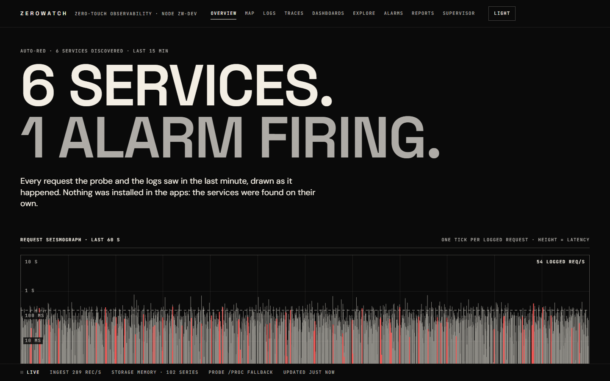

</div>

---

## Contents

- [Why ZeroWatch](#why-zerowatch)
- [Features](#features)
- [Screenshots](#screenshots)
- [Quick start](#quick-start)
- [Architecture](#architecture)
- [How the supervisor works](#how-the-supervisor-works)
- [Ingest APIs](#ingest-apis)
- [Querying: metric math, PromQL and Grafana](#querying-metric-math-promql-and-grafana)
- [Forecasting, predictive alarms and reports](#forecasting-predictive-alarms-and-reports)
- [Deployment modes](#deployment-modes)
- [Kubernetes (Helm)](#kubernetes-helm)
- [Security: API keys, SigV4, OIDC and roles](#security-api-keys-sigv4-oidc-and-roles)
- [Long-term storage: S3/MinIO tiering and retention](#long-term-storage-s3minio-tiering-and-retention)
- [Configuration reference](#configuration-reference)
- [Development](#development)
- [Project layout](#project-layout)
- [Status and limits](#status-and-limits)
- [Roadmap](#roadmap)
- [License](#license)

---

## Why ZeroWatch

AWS CloudWatch is powerful, but you have to wire it up yourself:
- instrument the code;
- install and configure the agent;
- pick metrics and write dashboards;
- guess alarm thresholds;
- pay per custom metric.

ZeroWatch keeps the CloudWatch data model and APIs, so existing `PutMetricData` / `PutLogEvents` / `GetMetricData` clients keep working, and it automates the rest:

| | CloudWatch | ZeroWatch |
|---|---|---|
| Request metrics (rate, errors, latency) | Instrument the code or install X-Ray | **eBPF, no code changes** (plaintext and OpenSSL TLS) |
| Log shipping | Configure the agent per file | **Discovers log files and infers their formats** |
| Dashboards | Built by hand | **Generated per service and per host**, rebuilt as services change |
| Alarm thresholds | Guessed | **Self-calibrated** from the history; Holt-Winters/STL anomaly bands |
| "Will the disk fill?" | Not built in | **Predictive alarms** on a forecast, with a capacity runway |
| Cost model | Per metric, per query | Flat: Gorilla-compressed storage, no per-metric charge |
| Grafana | Plugin | **Built-in Prometheus-compatible API** (PromQL subset) |

## Features

- **Zero-touch supervisor.** It finds processes, listening ports and containers. It attaches an eBPF probe (or a `/proc` fallback) for RED metrics, tails and parses logs, and synthesizes dashboards and alarms. It stays under a 1 % CPU budget.
- **eBPF RED metrics.** It parses HTTP/1.x in the kernel: plaintext through syscalls, and HTTPS through OpenSSL `SSL_read`/`SSL_write` uprobes. It handles containers in their own PID namespaces.
- **CloudWatch-compatible ingest.** Query and JSON protocols with SigV4 verification, plus OTLP (JSON and protobuf, metrics, logs and traces), Prometheus remote write, StatsD, EMF (metrics embedded in log lines) and a native JSON API.
- **Time-series engine.** Gorilla-compressed chunks with 1-minute rollups. Exact percentiles. Metric math (`+ − × ÷ ^`, `AVG/SUM/MIN/MAX`, `RATE`, `DIFF`, `FILL`, …).
- **Logs.** Search with facets, live tail over SSE, and one click from a chart spike to that moment's logs.
- **Traces.** OTLP traces, a span waterfall, and a duration scatter. Logs link to traces through `trace_id`.
- **Alarms.**
  - M-of-N state machine and TreatMissingData, plus a 24 h simulator and a backtest for predictive rules.
  - Actions: webhook, Slack, PagerDuty and SNS.
- **Anomaly detection.** Holt-Winters and robust STL bands.
- **Forecasting.**
  - Built-ins: Holt-Winters, STL, damped Holt and seasonal-naive, with automatic method and season selection and calibrated 80 % intervals.
  - An optional model sidecar: Chronos-Bolt by default, TimesFM 2.5 optional.
- **Reports.** 24 h, 7 d and 30 d summaries in HTML: a narrative, a services table, alarm activity, anomalies, the slowest traces, and a capacity runway. Sent to Slack, a webhook or the log on a schedule.
- **Node metrics.** CPU, memory, swap, disks, inodes, disk I/O and network, with forecasts on a per-host board.
- **Grafana.** A Prometheus-compatible query API at `/prometheus` (PromQL subset), so Grafana's built-in Prometheus datasource works.
- **Multi-node cluster.**
  - Memberlist gossip, a consistent-hash ring, replica failover and exact scatter-gather reads.
  - Traces routed to their ring owner, and ring-aware Kafka consumers.
- **Storage backends.** In-memory with S3/MinIO cold tiering and per-tenant retention, or ClickHouse. The commit log is in-memory or Kafka.
- **Security.** API keys with roles, SigV4, OIDC single sign-on (auth code + PKCE), RBAC (viewer, editor, admin), CSRF protection, rate limiting and security headers.
- **Web UI.** React 19 with hand-drawn SVG charts (no chart library), light and dark themes, and a layout that works at phone widths.
- **Kubernetes.** A Helm chart with single and cluster modes, a node-agent DaemonSet with eBPF, and a 29 MB distroless image.

## Screenshots

| | |
|---|---|
| **Overview:** Auto-RED totals, the request seismograph (one tick per logged request) and the services table.  | **Service map:** who talks to whom, read from the host's TCP table, with RED per node (demo topology from `npm run mock`). 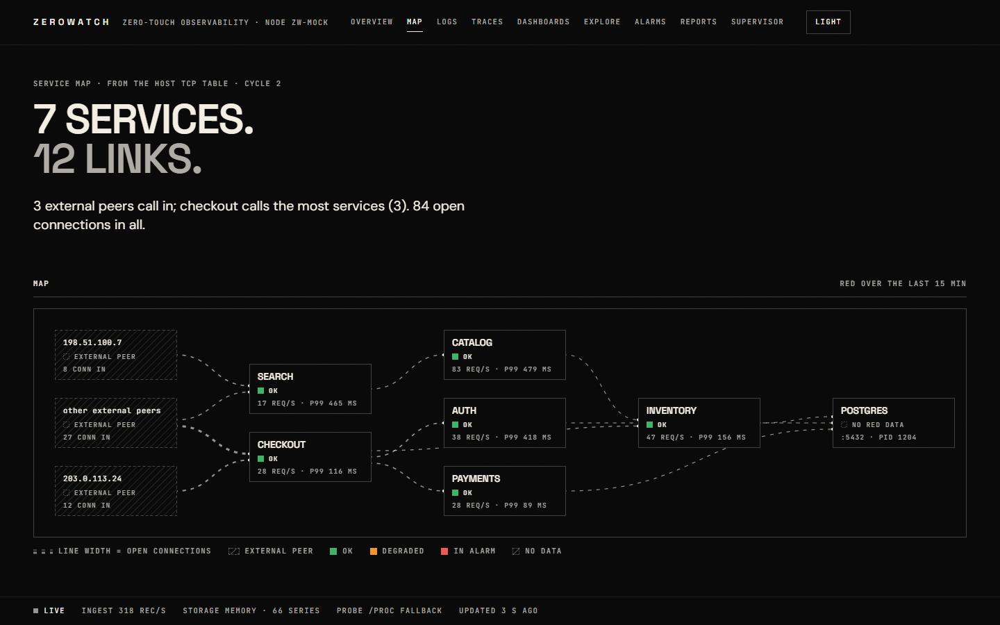 |
| **Logs:** volume histogram, facets and live tail. 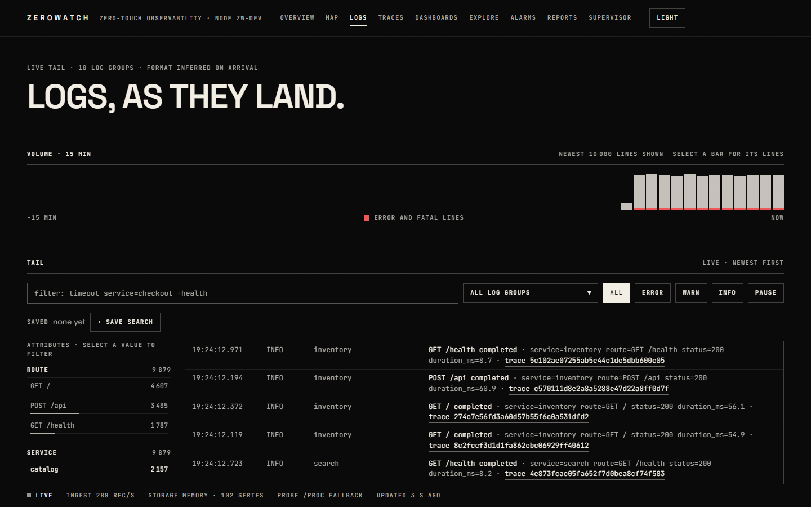 | **Traces:** duration scatter and span waterfall. 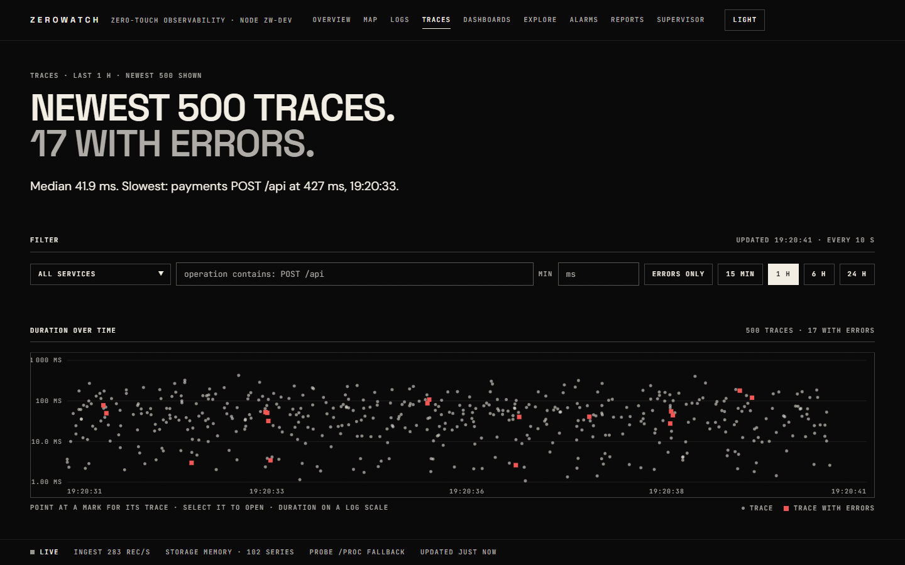 |
| **Host board:** generated by the supervisor, with memory/CPU/disk forecasts. 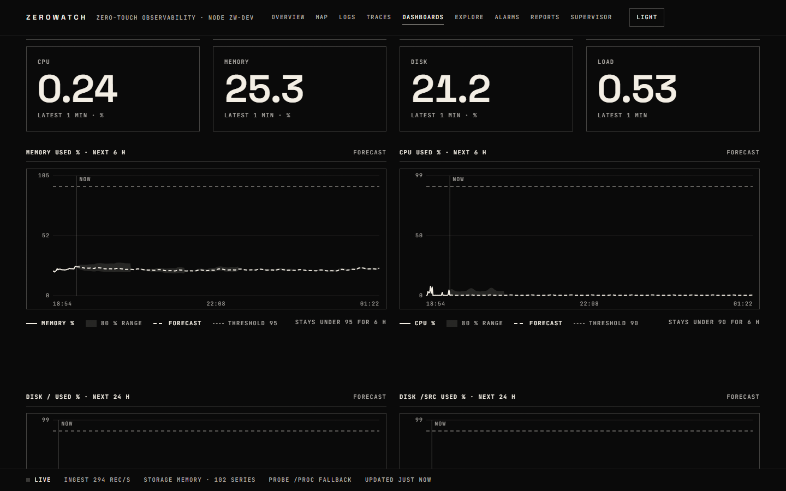 | **Explore:** metric math, anomaly bands and forecasts. 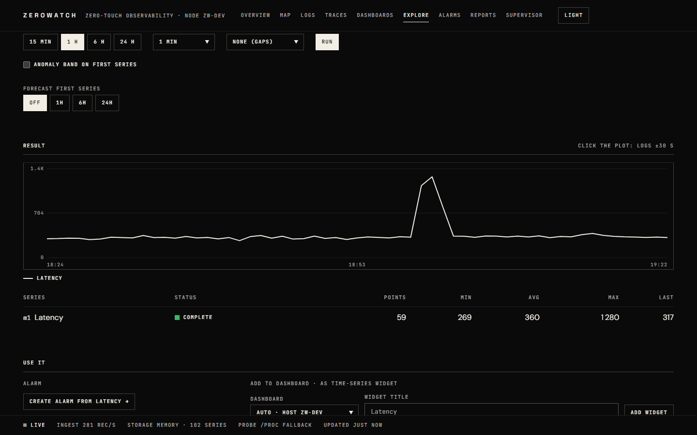 |
| **Alarms:** state, recent periods and Alarm Studio. 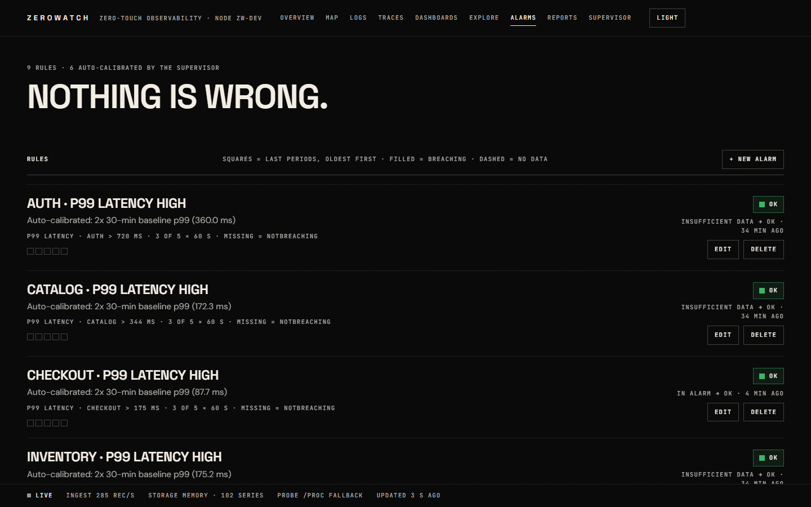 | **Reports:** narrative, capacity runway and services. 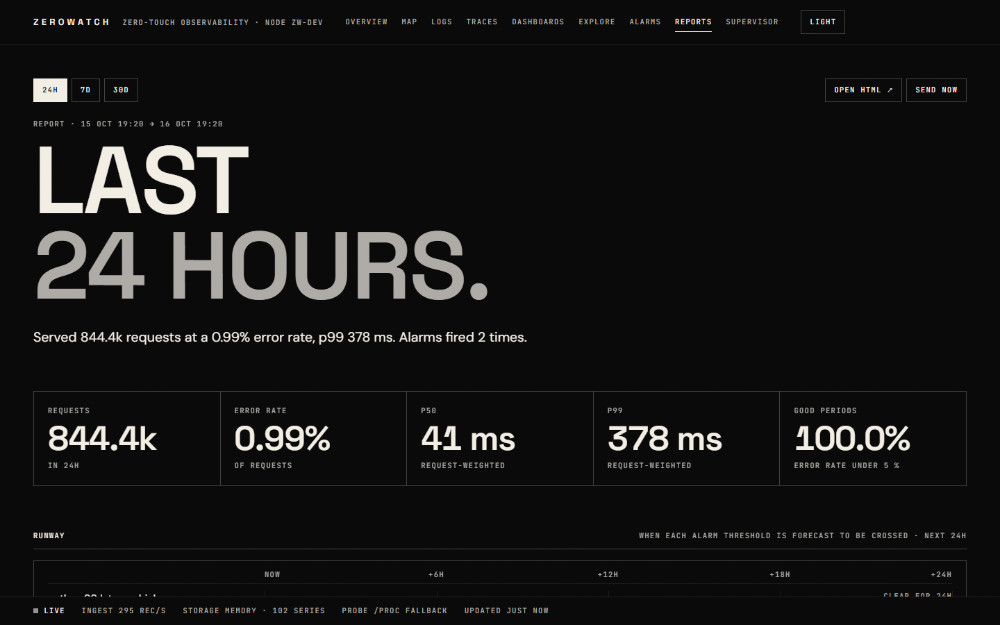 |
| **Supervisor:** the decision log, discovered services, log files and containers. 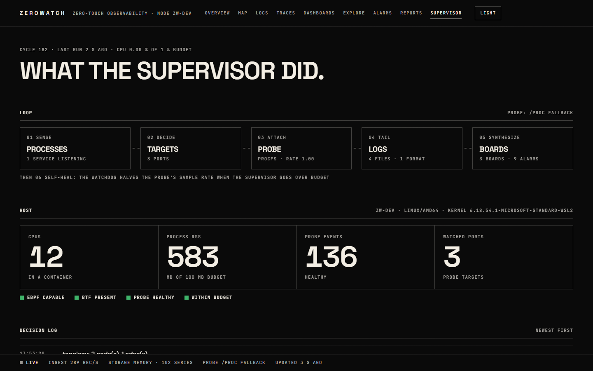 | **Light theme.** 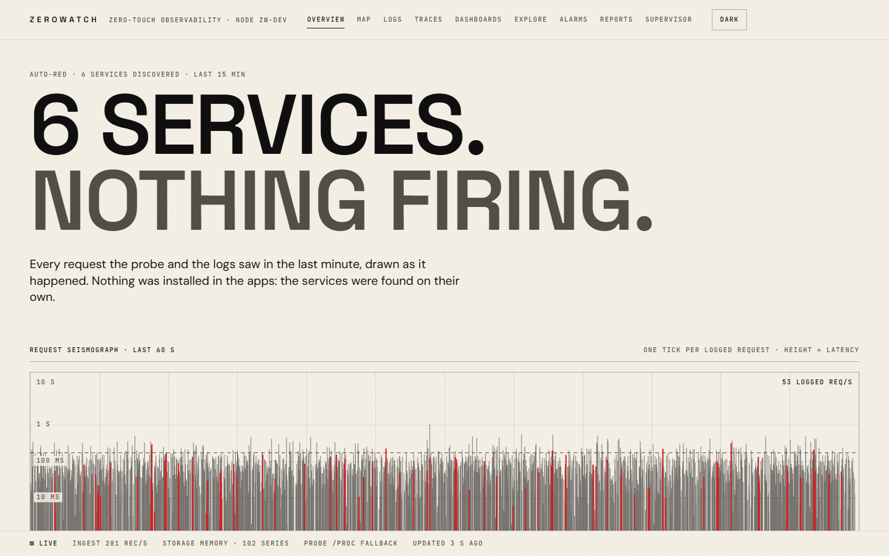 |

## Quick start

### With Go 1.23+

```bash
git clone https://github.com/himanshubaliyan7/zerowatch.git
cd zerowatch
go run ./cmd/zerowatch --role=all        # UI + API on http://localhost:8080
```

`--role=all` turns on a synthetic traffic generator (6 services × 3 routes, with incidents), so the UI has data straight away. Turn it off with `--generate=false`.

### With Docker only (no Go toolchain)

```bash
docker run --rm -p 8080:8080 -v "$PWD:/src" -v zw-gomod:/go/pkg/mod -w /src \
  golang:1.23 go run ./cmd/zerowatch --role=all --data-dir=/tmp/zw
```

### Container image

```bash
docker build -f deploy/docker/Dockerfile -t zerowatch .
docker run --rm -p 8080:8080 zerowatch --role=all
```

To watch a real Linux host from the container, give it the host's view:

```bash
docker run --rm --pid=host --privileged -p 8080:8080 \
  -v /:/host:ro -v /sys/kernel/tracing:/sys/kernel/tracing \
  zerowatch --role=all --host-root=/host --generate=false
```

### Send it something

```bash
# CloudWatch CLI / SDKs: point the endpoint at ZeroWatch
aws cloudwatch put-metric-data --endpoint-url http://localhost:8080/cloudwatch \
  --namespace MyApp --metric-name Latency --value 42 --unit Milliseconds

# OTLP (any OpenTelemetry SDK or collector)
export OTEL_EXPORTER_OTLP_ENDPOINT=http://localhost:4318

# Prometheus remote write
#   remote_write: [{ url: "http://localhost:8428/api/v1/write" }]

# StatsD
echo "checkout.latency:42|ms" | nc -u -w0 localhost 8125
```

## Architecture

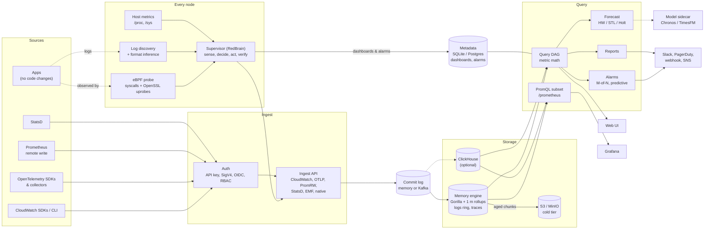

### Write and read path

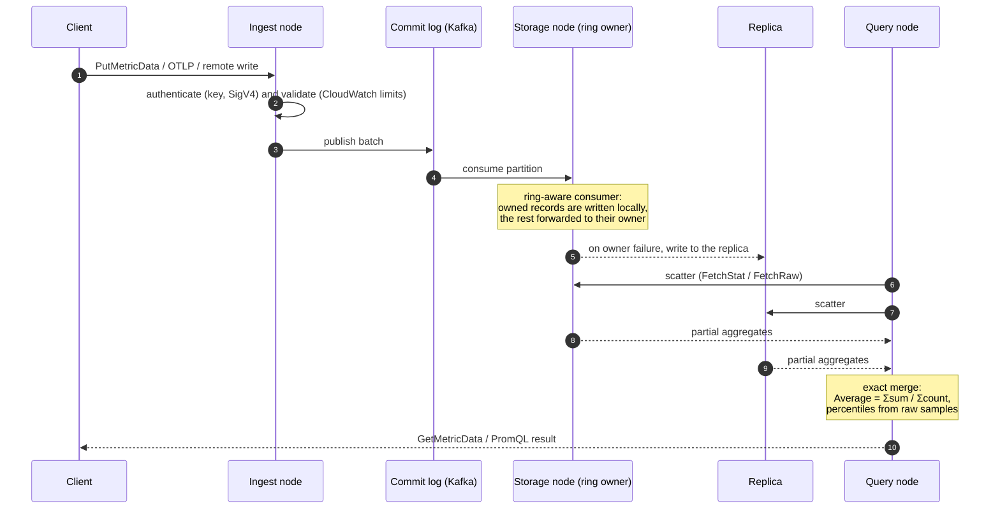

## How the supervisor works

The supervisor (RedBrain) runs a control loop every `--supervisor-interval` (10 s by default):

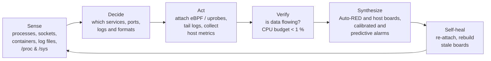

- **Services:** listening sockets are matched to processes by socket inode. The topology (who talks to whom) comes from the TCP table.
- **Request metrics:** the eBPF probe measures rate, errors and latency per service and route. The `/proc` fallback probe is used when eBPF can't load.
- **Logs:** files under `--log-roots` are found, their format inferred (JSON, logfmt, common log formats), and they're tailed into log groups.
- **Dashboards:**
  - `Auto-RED · Services` and one board per host: CPU, memory, disk forecasts, I/O and network.
  - A generated board that someone has edited is never overwritten.
- **Alarms:**
  - p99 latency and error-rate alarms with thresholds calibrated from the history.
  - Predictive alarms: "disk `/` will fill" (24 h forecast > 90 %) and "memory will run out" (1 h forecast > 95 %).

## Ingest APIs

| Protocol | Endpoint | Notes |
|---|---|---|
| CloudWatch query/JSON | `POST /cloudwatch` on `:8080` | `PutMetricData`, `GetMetricData`, `PutLogEvents`, …; SigV4 verified with `--aws-credentials` |
| OTLP/HTTP | `:4318` `/v1/metrics`, `/v1/logs`, `/v1/traces` | JSON or protobuf, gzip |
| Prometheus remote write | `:8428` `/api/v1/write` | snappy protobuf |
| StatsD | `:8125/udp` | counters, gauges, timers |
| EMF | inside log events | CloudWatch Embedded Metric Format becomes metrics |
| Native JSON | `POST /api/v1/ingest/{metrics,logs}` | |

## Querying: metric math, PromQL and Grafana

**Metric math** (`POST /api/v1/query`, GetMetricData semantics):

```json
{
  "start": "now-1h", "end": "now", "period": 60,
  "queries": [
    { "id": "e", "metricStat": { "namespace": "ZeroWatch/RED", "metricName": "Errors", "dimensions": { "Service": "checkout", "Route": "*" }, "stat": "Sum" } },
    { "id": "r", "metricStat": { "namespace": "ZeroWatch/RED", "metricName": "Requests", "dimensions": { "Service": "checkout", "Route": "*" }, "stat": "Sum" } },
    { "id": "rate", "expression": "100 * e / r" }
  ]
}
```

A query names a series' full dimension set; `"*"` matches any value.

**Grafana:** add a *Prometheus* datasource:
- **URL:** `http://<host>:8080/prometheus`
- **Auth (when API keys are on):** a custom HTTP header `Authorization: Bearer <api-key>`

How series appear in PromQL:
- **Name:** `<namespace>_<metric>`, sanitized. For example, `ZeroWatch/Host` + `CPUUtilization` becomes `ZeroWatch_Host_CPUUtilization`.
- **Labels:** `namespace`, `metric`, `stat` and every dimension.
- **Statistic:** `stat="p99"` (or any CloudWatch statistic) picks one. The default is `Average`.

```promql
sum by (Service) (rate(ZeroWatch_RED_Requests{stat="Sum"}[5m]))
topk(3, ZeroWatch_Host_MemoryUsedPercent)
```

What the PromQL subset covers:
- **Supported:** selectors and matchers, range/offset, `rate`/`irate`/`increase`/`delta`, `*_over_time`, the aggregations (with `by`/`without`, `topk`, `quantile`), arithmetic, comparison and set operators, and `on`/`ignoring` one-to-one matching.
- **Not supported:** `group_left`/`right`, subqueries, `@`, `histogram_quantile` and `label_replace`. These return a clear `unsupported` error.

## Forecasting, predictive alarms and reports

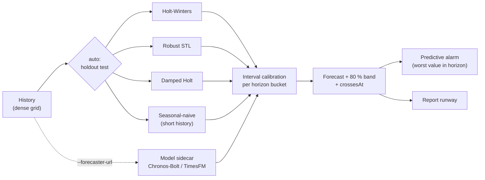

- `POST /api/v1/forecast` returns the forecast, the 80 % band, the method used and when it crosses a threshold (`crossesAt`).
- On a young node, the built-ins look for a shorter season with autocorrelation, so a node with an hour of data still gets seasonal forecasts.
- Predictive alarms: set `forecastHorizonSec` on a rule. `POST /api/v1/alarms/backtest` replays the rule over history and reports how many minutes earlier it would have fired than the observed value crossed.
- Model sidecar (`forecaster/`):

  ```bash
  docker build -t zerowatch-forecaster forecaster/
  docker run -p 8090:8090 zerowatch-forecaster
  zerowatch --forecaster-url=http://localhost:8090
  ```

- Benchmark: `forecaster/bench/bench.py` (rolling origin; MASE, sMAPE, interval coverage, latency). The latest results are in [`forecaster/bench/results.md`](forecaster/bench/results.md).

  | Method (synthetic suite) | MASE h=12 | h=48 | h=288 | 80 % coverage |
  |---|---|---|---|---|
  | TimesFM 2.5 (sidecar) | 0.243 | 0.253 | 0.660 | 0.83 |
  | Chronos-Bolt-small (sidecar) | 0.260 | 0.278 | 0.713 | 0.82 |
  | **ZeroWatch `auto` (built-in)** | **0.293** | **0.304** | **0.829** | **0.83** |
  | Holt-Winters (built-in) | 0.352 | 0.401 | 1.031 | 0.79 |
  | Seasonal-naive | 0.815 | 0.775 | 1.230 | — |

  The TimesFM and Chronos rows are from session 3 and the built-in rows from session 4; [`results.md`](forecaster/bench/results.md) has the full tables.

- Reports: `GET /api/v1/reports/summary[.html]?range=24h|7d|30d` and `POST /api/v1/reports/send`. To schedule them: `--report-targets slack:<url>,webhook:<url>,log --report-every 24h`.

## Deployment modes

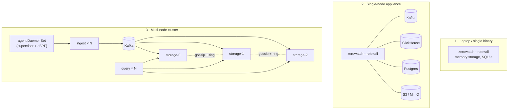

| Role | Runs |
|---|---|
| `all` | everything in one process (default) |
| `ingest` | ingest APIs → commit log |
| `storage` | owns a shard of the ring; consumes the commit log |
| `query` | query API, UI, alarms, reports |
| `supervisor` | the node agent: discovery, eBPF, logs, host metrics |

The cluster flags are `--cluster-seeds host1:7946,host2:7946`, `--gossip-port` and `ZW_CLUSTER_SECRET`, which authenticates internal RPC. `GET /api/v1/cluster` shows the members and the ring.

## Kubernetes (Helm)

```bash
docker build -f deploy/docker/Dockerfile -t zerowatch:dev .
helm install zw deploy/helm/zerowatch                                   # single node
helm install zw deploy/helm/zerowatch --set mode=cluster \
  --set agent.enabled=true                                              # cluster + node agent
```

- **single:** a Deployment with `role=all` and a PVC.
- **cluster:**
  - a storage StatefulSet (3 replicas, a PVC each, seeds via a headless service);
  - ingest and query Deployments with optional HPAs;
  - Services and an Ingress.
- **agent:**
  - a DaemonSet with `role=supervisor`, `hostPID`, and read-only host mounts;
  - eBPF with `BPF`/`PERFMON`/`SYS_PTRACE` capabilities (privileged is optional).
  - Its Host dimension is set from `spec.nodeName`.
- **Optional:** the forecaster sidecar, external Kafka/ClickHouse/Postgres, NetworkPolicy, ServiceMonitor and `existingSecret`.
- **Checks:** `bash deploy/helm/verify.sh` (helm lint + kubeconform) and `deploy/helm/kind-e2e.sh` (real install in kind). See [`deploy/helm/zerowatch/README.md`](deploy/helm/zerowatch/README.md).

## Security: API keys, SigV4, OIDC and roles

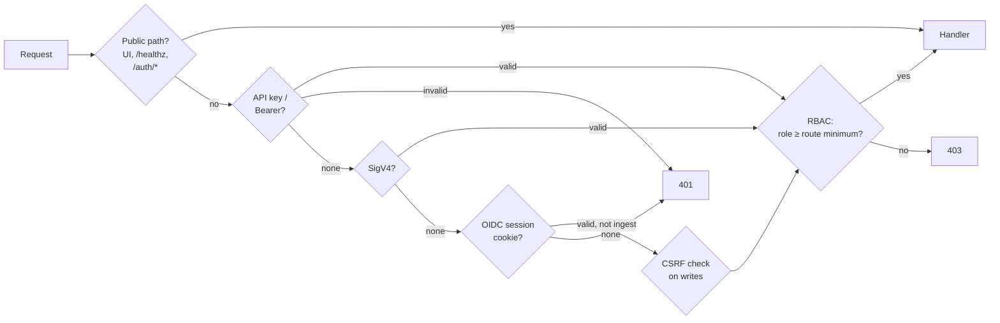

- **API keys:** `--api-keys KEY:tenant[:role]` (keys must be 16 characters or more; the role defaults to `admin`). Send them as `X-API-Key: <key>` or `Authorization: Bearer <key>`.
- **SigV4:** `--aws-credentials AKID:SECRET:tenant` (prefer the `ZW_AWS_CREDENTIALS` env var).
- **OIDC single sign-on** (any provider: Keycloak, Auth0, Okta, Google, Entra):
  ```bash
  ZW_OIDC_CLIENT_SECRET=... ZW_SESSION_KEY=$(openssl rand -hex 32) zerowatch \
    --oidc-issuer=https://idp.example.com/realms/zw --oidc-client-id=zerowatch \
    --oidc-redirect-url=https://zw.example.com/auth/callback \
    --oidc-role-claim=roles --oidc-role-map=zw-editors=editor,zw-admins=admin
  ```
  - The flow is auth code + PKCE. ID tokens are verified with RS256 or ES256 against the provider's JWKS.
  - The session is an encrypted, signed cookie that lasts 8 h.
  - *Keycloak:* add a "User Realm Role" mapper to the client (claim `roles`, "Add to ID token" on), because Keycloak puts realm roles only in the access token by default.

  | Role | Can |
  |---|---|
  | `viewer` | read everything, run queries, forecasts and simulations, use Grafana |
  | `editor` | also change dashboards, alarms and saved searches, send reports, ingest (with a key) |
  | `admin` | everything else |

  Ingest endpoints accept only API keys or SigV4, never the browser cookie.

## Long-term storage: S3/MinIO tiering and retention

```bash
ZW_TIER_ACCESS_KEY_ID=... ZW_TIER_SECRET_ACCESS_KEY=... zerowatch \
  --tier-bucket=zerowatch --tier-s3-endpoint=http://minio:9000 --tier-hot=24h \
  --retention=raw=7d,rollup=90d,logs=7d --retention-tenant=2:raw=30d
```

- Data older than the hot window moves to immutable segment objects: `<prefix>/<tenant>/{raw|1m|logs}/yyyy/mm/dd/hh/<shard>-<seq>.zwseg`, plus an hourly manifest.
- Queries merge hot and cold data exactly. A test checks this: every statistic over 3 days of data matches an all-in-memory engine.
- Reads fetch only the blocks they need with HTTP Range requests, through a byte-bounded LRU cache.
- Retention runs per tenant, with or without a bucket.
- For testing: `docker compose --profile tier up -d minio` in `deploy/compose/`.

## Configuration reference

Every flag also has an environment variable (`--flag-name` → `ZW_FLAG_NAME`). Secrets are read **only** from the environment.

| Flag | Default | |
|---|---|---|
| `--role` | `all` | `all`, `ingest`, `query`, `storage`, `supervisor` |
| `--http-addr` / `--otlp-addr` / `--prom-addr` / `--statsd-addr` | `:8080` / `:4318` / `:8428` / `:8125` | listeners |
| `--data-dir` | `./data` | local data |
| `--storage` | `memory` | `memory` or `clickhouse` (`--clickhouse-url`, `--clickhouse-db`) |
| `--commitlog` | `memory` | `memory` or `kafka` (`--kafka-brokers`, `--kafka-topic`) |
| `--metadata-dsn` | SQLite in data dir | `postgres://…` for a shared store |
| `--cluster-seeds`, `--gossip-port`, `--node-name` | | cluster mode; `ZW_CLUSTER_SECRET` for internal RPC |
| `--api-keys`, `--aws-credentials`, `--cors-origins` | | auth (prefer env vars) |
| `--oidc-*`, `ZW_OIDC_CLIENT_SECRET`, `ZW_SESSION_KEY` | | OIDC sign-in |
| `--tier-*`, `--retention`, `--retention-tenant` | | cold tier and retention |
| `--supervisor`, `--supervisor-interval`, `--host-metrics`, `--host-root`, `--hostname`, `--log-roots`, `--bpf-object` | `auto`, `10s`, on, …, `/var/log` | node agent |
| `--generate` | `auto` (on for `role=all`) | synthetic traffic |
| `--forecaster-url` | | model sidecar |
| `--report-targets`, `--report-every`, `--report-range` | | scheduled reports |
| `--prometheus-api` | `true` | the `/prometheus` API |

Run `zerowatch --help` for the full list.

## Development

```bash
go vet ./... && go test ./...                 # all Go tests
go test -tags integration ./internal/...      # ClickHouse, Redpanda, MinIO (see deploy/compose/README.md)
cd web && npm install
npm run dev          # Vite on :5173, proxied to a local zerowatch on :8080
npm run mock         # no Go needed: a mock API + the built UI on :8787
npm run build        # type check + build web/dist (embedded into the binary via go:embed)
```

- `web/dist` is committed on purpose: the Go binary embeds it at compile time, so `go run` works without Node.
- **eBPF build** (Linux, clang + libbpf): `clang -O2 -g -target bpf -c ebpf/red_probe.bpf.c -o ebpf/red_probe.bpf.o && go build -tags ebpf ./...`.
- **Kernel tests** (privileged): the procedure is in [`ebpf/README.md`](ebpf/README.md).
- **Default build:** without the `ebpf` tag, the build uses the `/proc` fallback probe.

## Project layout

```
cmd/zerowatch/        entry point; wires every role
internal/
  model/              canonical types, CloudWatch limits
  ingest/ emf/        CloudWatch, OTLP, Prom remote write, StatsD, EMF
  commitlog/          memory ring or Kafka (franz-go)
  storage/ codec/     engine interface, memory engine (Gorilla), ClickHouse
  tier/ awssig/       S3/MinIO cold tier + retention, SigV4 signer
  query/ promapi/     metric math DAG, PromQL subset
  alarms/ anomaly/    M-of-N alarms and notifiers, Holt-Winters & STL
  forecast/ reports/  forecasting service, reports
  cluster/            gossip, hash ring, scatter-gather, routed traces, Kafka routing
  supervisor/         RedBrain loop, log discovery, topology
  hostmetrics/ procfs/ node metrics, /proc readers
  traces/ live/       trace store, SSE hub
  httpx/ authn/ api/  HTTP plumbing, auth (keys, SigV4, OIDC, RBAC), routes
  metadata/ config/   dashboards/alarms store, flags
ebpf/                 BPF C probe + cilium/ebpf loader, TLS uprobes
web/                  React 19 + Vite + Tailwind 4 UI (embedded)
forecaster/           optional Python model sidecar + benchmark
deploy/               docker, helm chart, compose (ClickHouse, Redpanda, MinIO), systemd
```

## Status and limits

ZeroWatch is a working prototype: every feature above is implemented and covered by tests, and the main paths have been run end to end (real kernel eBPF, ClickHouse, Redpanda, MinIO, Keycloak, Grafana 11, kind). It is **not yet production-hardened**.

Known limits:
- **eBPF:** covers HTTP/1.x, plaintext or OpenSSL TLS, on x86-64. HTTP/2/gRPC, Go `crypto/tls`, BoringSSL and rustls are not covered. Topology and eBPF need root (or `CAP_BPF`/`CAP_SYS_PTRACE`).
- **Alarms in a cluster:** every query replica evaluates alarms and sends notifications (no leader election yet).
- **OIDC:** tested live only with Keycloak. Sign-out is local only (no end-session redirect).
- **Tiering:** tested against MinIO, not AWS S3. Up to 1 h of queued data is lost on a crash.
- **ClickHouse:** has its own TTLs and doesn't use the cold tier.

## Roadmap

- [ ] Leader election for alarms and scheduled reports
- [ ] A Prometheus `/metrics` endpoint for self-monitoring; `--gossip-advertise-addr`
- [ ] eBPF: HTTP/2 and gRPC (HPACK), `readv`/`sendmsg`/io_uring, Go `crypto/tls` uprobes
- [ ] Kubernetes mutating webhook for runtime injection (JVM, Node, Python)
- [ ] Wire the OIDC and tiering settings into the Helm chart's values
- [ ] Show cold-only series in series listings; a WAL for the tier upload queue
- [ ] UI: hide edit controls for viewers; show TLS probe and tier stats
- [ ] Published container images and a release workflow

## License

ZeroWatch is licensed under the [Apache License 2.0](LICENSE).
